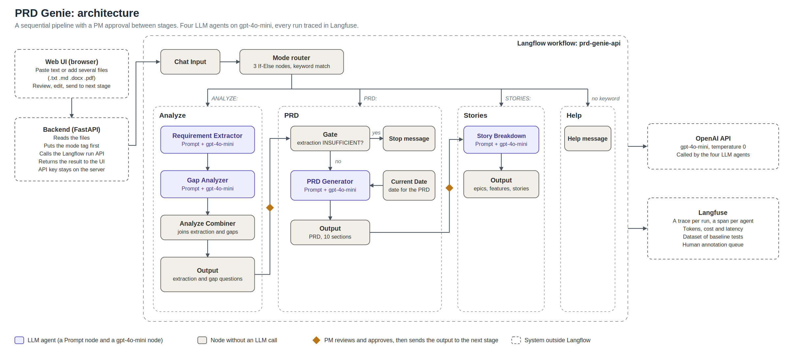
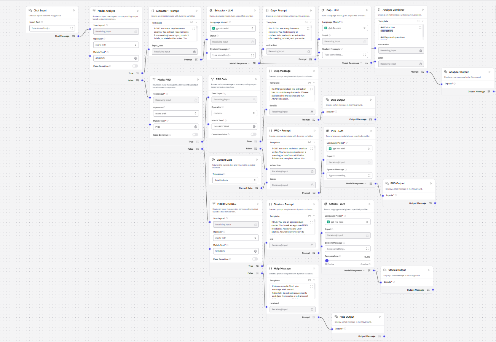
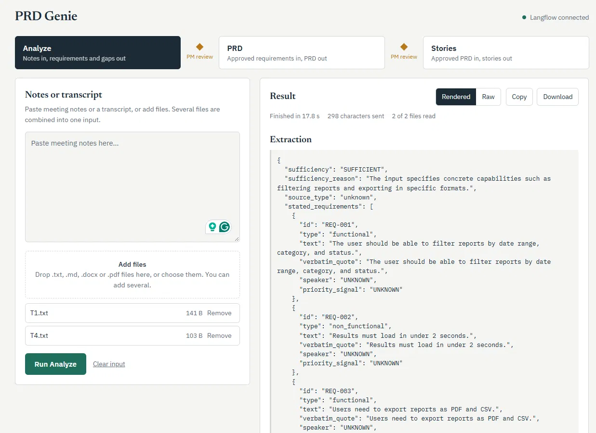
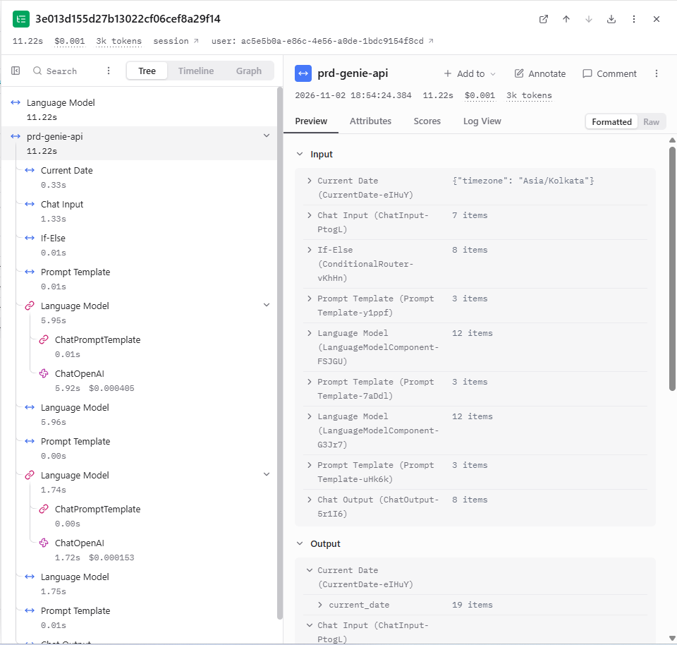
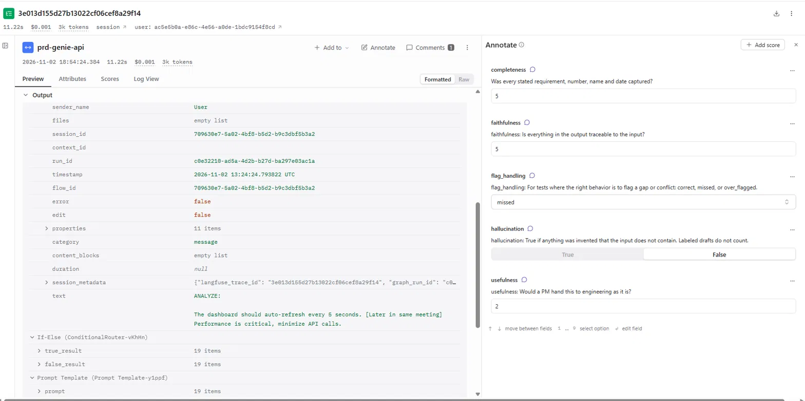

# PRD Genie

A multi-agent pipeline that turns meeting transcripts, stakeholder notes and product briefs into structured PRDs, epics, features and user stories, without inventing requirements that nobody stated.

Capstone project for *Applied Agentic AI for PMs/TPMs*. The company in the scenario (NeuronForge Technologies) is fictional.



## What it does

1. **Analyze.** A Requirement Extractor reads the text and returns only what was stated: requirements with exact quotes, acceptance criteria, stakeholders, deadlines, dependencies, ambiguous items, contradictions and risks. A Gap Analyzer then writes one clarification question per gap.
2. **PRD.** A gate blocks the stage if the extraction is marked INSUFFICIENT. Otherwise a PRD Generator fills a fixed 10-section template using only the extraction.
3. **Stories.** A Story Breakdown agent writes epics, features and stories from the approved PRD, with acceptance criteria copied verbatim and a priority suggestion on each story.

The PM reviews and approves the output of each stage before running the next. Every item in the output traces back to the source, and anything the agent is unsure about is left as `Not specified in source` or flagged as a question.

## How it is built

| Part | Choice |
|---|---|
| Workflow | Langflow (visual multi-agent flow, keyword router, run API) |
| LLM | gpt-4o-mini, temperature 0, for all four agents |
| Observability | Langfuse (traces, dataset of baseline tests, human annotation queue) |
| Input | Pasted text or files: .txt, .md, .docx, .pdf (several at a time) |
| Output | Markdown |
| UI | Small FastAPI backend and a single-page browser UI |

**Orchestration pattern:** a sequential pipeline (Analyze, PRD, Stories) with human approval between stages, entered through a keyword router (`ANALYZE:`, `PRD:`, `STORIES:`). The router is plain text matching, not an LLM, so it costs nothing and cannot misroute. The full rationale is in `docs/Architecture_Writeup.pdf`.

## Results

Evaluated on the 12 baseline inputs from the problem statement, run as 17 stage runs (10 Analyze, 4 PRD, 3 Stories). Every output is recorded in `evals/baseline_results.xlsx`.

| Measure | Result |
|---|---|
| Baseline tests that meet their criteria | 11 of 12 (T3 fails: an implicit trade-off between two statements is not detected) |
| Runs with an unsupported detail | 1 of 17 (a role expanded from PM to Product Manager) |
| Human annotation of 9 traces (Langfuse queue) | Faithfulness 4.9 of 5, completeness 4.7, usefulness 3.3. The agents rarely invent, but sometimes fail to flag or capture something (T3, T5, T7) |
| Time for one full chain | about 36 seconds |
| Cost for one full chain | about $0.0022 |
| Cost per PM per month (3 document lifecycles a day, an assumption) | about $0.17 |

Cost figures are measured in Langfuse. See `docs/cost_analysis.md`.

## Screenshots

| | |
|---|---|
|  |  |
|  |  |

## Repository structure

```
workflows/   Langflow export (no API keys)
prompts/     The four agent prompts as text files
ui/          Backend and browser UI (see ui/README.md)
docs/        Architecture diagram, writeup, ideation (Q1), program charter (Q2), reflection (Q4), slide deck, cost analysis
evals/       Baseline results, test inputs, Langfuse dataset, annotation rubric
screenshots/ Canvas, UI, trace and annotation queue
```

## Run it

You need Python 3.10 to 3.13, an OpenAI API key, and a free Langfuse project.

1. **Install Langflow.** `pip install langflow`
2. **Set the Langfuse variables** in the same terminal, before starting Langflow:
   `LANGFUSE_SECRET_KEY`, `LANGFUSE_PUBLIC_KEY`, `LANGFUSE_HOST`.
3. **Start Langflow.** `langflow run`, then open the address it prints.
4. **Import the flow.** Import `workflows/prd-genie-api.json`. In Settings, add a global variable named `OPENAI_API_KEY` with your key. The export contains no keys.
5. **Start the UI.** In `ui/`, copy `.env.example` to `.env`, set `LANGFLOW_FLOW_ID` (the id in the flow's address) and `STUB=0`, then run `start.bat` (Windows) or `./start.sh`. Open http://127.0.0.1:8000.

To try the interface without Langflow, keep `STUB=1`. It returns sample output and calls no model.

Never commit `.env`. It is listed in `.gitignore`.

## Known limitations

- An implicit trade-off inside one statement is not detected (T3). Explicit disagreements between people are.
- Output varies between runs even at temperature 0.
- The PRD sometimes repeats acceptance criteria as functional requirements.
- Stories are thin by design: the agent drafts no business rules. A questions-first step is the planned fix.
- When the input names something without identifying it (which competitor, which API), the Gap agent does not ask which one is meant.
- Typed answers inside a paused run are not supported by Langflow's Human Input component, which offers buttons only.

## Roadmap

A questions-first step for the PM, better conflict detection, an automated judge checked against human scores, a scope estimator, and a market research flow kept separate from stated requirements.
